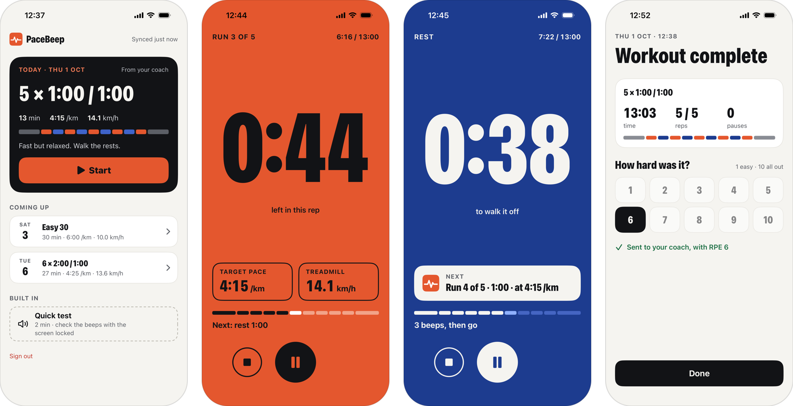
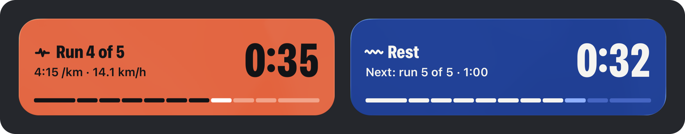
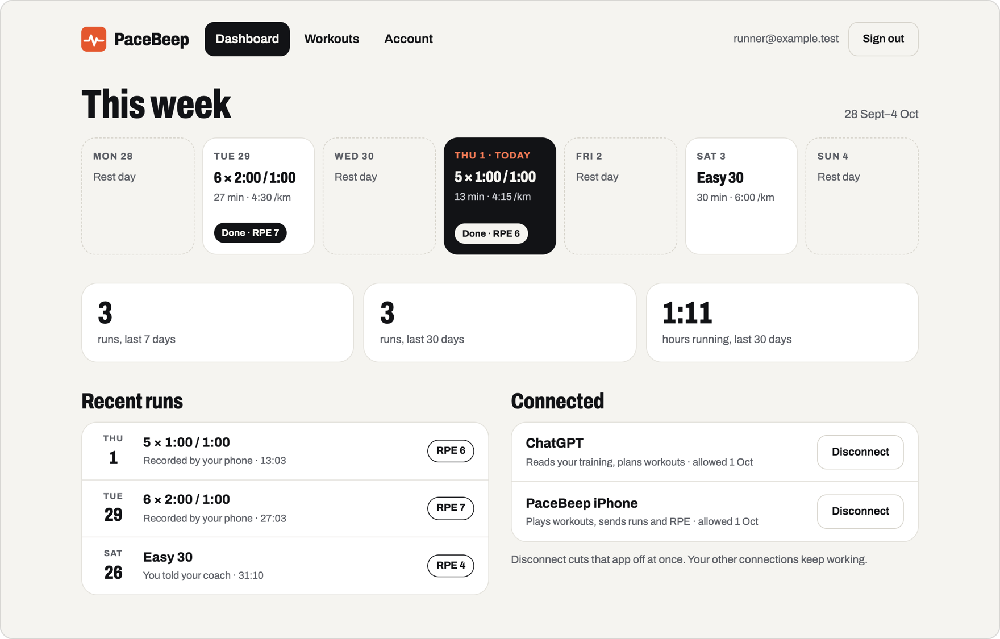

# PaceBeep

**Your AI coach writes the workout. Your iPhone beeps it on the lock screen.**

Free, ad-free, open-source iOS interval & gym timer: Claude, ChatGPT, Muse, or any MCP client plans sessions over OAuth; the SwiftUI app runs them as a Live Activity (lock screen / Dynamic Island) with beeps and Done/Skip; you rate difficulty and the coach sees it.

[](https://apps.apple.com/app/pacebeep/id6818211974)

[](LICENSE)
[](https://github.com/gadshushan3030/pacebeep/stargazers)

**[Get it on the App Store](https://apps.apple.com/app/pacebeep/id6818211974)** · **[pacebeep.vercel.app](https://pacebeep.vercel.app)** · [Connect your AI coach](#connect-your-ai-coach-via-mcp) · [Contributing](#contributing)

No ads, no subscription, no tracking. MIT. Author: [Gad Soussan](https://x.com/ShushanGad) ([@ShushanGad](https://x.com/ShushanGad)).

<!-- PLACEHOLDER: lock-screen Live Activity GIF/screenshot
     Add docs/media/lock-screen-live-activity.gif (see docs/media/README.md), then replace this block with:
     
-->
> **Media placeholder:** lock-screen / Dynamic Island recording goes in [`docs/media/lock-screen-live-activity.gif`](docs/media/README.md). Until then, see the stills below.



## How it works

1. **Coach** — You ask Claude, ChatGPT, Muse, or any MCP client to plan your week.
2. **MCP** — The assistant connects to PaceBeep’s hosted MCP server over OAuth and writes workouts into *your* account.
3. **Phone** — The iPhone app pulls those workouts, plays them with beeps that survive the lock screen, shows a Live Activity, and sends the run + your RPE back to the coach.


Every new account starts with three starter workouts, so you can try the beeps before an assistant is connected.

## Connect your AI coach via MCP

Production MCP endpoint (OAuth, Streamable HTTP):

```text
https://pacebeep.vercel.app/mcp
```

That URL is the app’s MCP resource (`BETTER_AUTH_URL` + `/mcp`). Discovery and auth metadata are live:

- Protected resource: `https://pacebeep.vercel.app/.well-known/oauth-protected-resource/mcp`
- Authorization server: `https://pacebeep.vercel.app/api/auth` (RFC 8414 via `/.well-known/oauth-authorization-server/api/auth`)

Self-hosted: use `https://<your-app>/mcp` instead (see [Deploy your own](#deploy-your-own-vercel--neon)).

### ChatGPT

1. ChatGPT → Settings → Security and login → **Developer mode**.
2. [chatgpt.com/plugins](https://chatgpt.com/plugins) → **Add** → Create MCP App → URL `https://pacebeep.vercel.app/mcp`, authentication **OAuth**.
3. Sign in to PaceBeep, check the app name and return address, **Allow**.
4. In ChatGPT’s **Work** tab, type `@` and pick the app.

### Claude / Claude Desktop / Cursor / other MCP clients

Point a remote MCP client at the same URL. OAuth is negotiated by the client (dynamic client registration + PKCE); you approve on PaceBeep’s consent page.

Example Cursor / Claude-style `mcpServers` entry (URL-only remote server):

```json
{
  "mcpServers": {
    "pacebeep": {
      "url": "https://pacebeep.vercel.app/mcp"
    }
  }
}
```

Exact key names vary by client; the important part is the URL above and OAuth support. After you allow access, try: *“Use PaceBeep: get my summary, then plan three interval sessions this week.”*

Registry metadata for the same remote server lives in [`server.json`](server.json).

### MCP tools

| Tool | What it does |
|---|---|
| `get_summary` | Runs and distance for 7/30 days, last run, upcoming workouts |
| `list_workouts` / `get_workout` | Workout plans |
| `create_workout` / `plan_week` | Create one / several scheduled workouts |
| `update_workout` | Change a plan |
| `list_runs` / `get_run` | Runs with planned vs. actual per interval, plus feedback |
| `record_run` | Store a run (`manual` when the runner reports it in chat) |
| `add_run_feedback` | RPE 1–10 and notes for a run |

## Architecture overview

| Path | Role |
|---|---|
| **web/** | Next.js 16 backend + dashboard on Vercel: accounts, workouts, runs, OAuth, MCP at `/mcp` |
| **ios/** | SwiftUI app: timed intervals with background-audio beeps, Live Activity, offline outbox, RPE |
| **design/** | Canvas source, color and type tokens |
| **docs/** | Architecture brief, launch notes, screenshots, [good first issues](docs/good-first-issues.md) |

```
iPhone (SwiftUI) ──── OAuth 2.1 + PKCE ───┐
                                          ▼
ChatGPT / Claude / MCP client ──►  Next.js on Vercel
                                   ├─ /api/auth/*     Better Auth + OAuth 2.1
                                   ├─ /.well-known/*  discovery
                                   ├─ /oauth/consent  you approve each coach
                                   ├─ /api/*          REST for the iPhone app
                                   └─ /mcp            MCP (token aud = /mcp)
                                            │
                                            ▼
                                   Postgres (Neon), every row scoped by user_id
```

More detail: [docs/AGENT_BRIEF.md](docs/AGENT_BRIEF.md). Auth + MCP alone as a template: **[MCP OAuth Starter](https://github.com/gadshushan3030/mcp-oauth-starter)**.

### Screens

With the screen locked, the run stays on the lock screen as a Live Activity, and in the Dynamic Island while you use other apps: orange to run, blue to rest.



On the web: the week your coach planned, what you ran and how it felt, and which apps can see your data.



### Accounts, reminders, data

- **Accounts**: Continue with Apple / Google (when configured) or email + password (Better Auth). Set `SIGNUP_ENABLED=false` to close registration. New accounts get three starter workouts.
- **Agents**: dynamic client registration → you approve on `/oauth/consent` → access token bound to `<BETTER_AUTH_URL>/mcp`. **Disconnect** on the dashboard deletes that user’s consent and tokens immediately.
- **Reminders**: coach creates/changes a workout → `pending` → optional APNs push → you approve in the app → local notification at the scheduled time.
- **Data**: `workouts` (plans), `runs` (what happened), `run_feedback` (RPE/notes). Writes carry a `request_id` so retries never duplicate.


### The iPhone app’s API

The app is another OAuth client of the same server (redirect `app.vercel.pacebeep:/oauth/callback`, PKCE, no secret):

| Route | What it does |
|---|---|
| `GET /api/workouts` | Upcoming / unscheduled workouts (`?blocks=1` for full gym workouts) |
| `POST /api/runs` | `{ request_id, run, feedback? }` — device run + optional RPE; idempotent |
| `POST /api/workouts/approve` | Runner OK for a coach-planned workout |
| `POST /api/devices` | APNs token registration (`DELETE` on sign-out) |

## Run locally (web)

Requires Node 22+ and Docker.

```bash
cd web
npm install
npm run db:up
cp .env.example .env.local   # then fill BETTER_AUTH_SECRET (openssl rand -hex 32)
npm run db:migrate
npm run dev -- -p 3200
```

Open http://localhost:3200 and create an account. Local MCP URL: `http://localhost:3200/mcp`.

## Run on your iPhone (ios)

Requires Xcode 26 and an Apple ID (a free one works; the app then expires after 7 days).

1. Xcode → Settings → Accounts → add your Apple ID.
2. The project’s team and bundle id are in `ios/Config.xcconfig`. Building your own copy: `cp ios/Local.xcconfig.example ios/Local.xcconfig` and set your team id and a bundle id of your own there.
3. Connect the iPhone, turn on Settings → Privacy & Security → Developer Mode, open `ios/PaceBeep.xcodeproj` and Run.
4. First launch: trust the developer in Settings → General → VPN & Device Management.

The App Store / default build talks to `https://pacebeep.vercel.app` (`SERVER_URL` in `ios/Config.xcconfig`). Sign in once, ask your assistant to plan your week, and workouts show up under **From your coach**; pull to refresh. Workouts are cached and finished runs wait in an outbox, so a gym without signal is fine.

The whole workout is rendered into one audio track (silence with beeps at exact times) and played with the background audio mode, so iOS keeps the app alive with the screen locked. After a run the app shows whether the audio played without gaps. Full (gym) workouts wait for **Done** / **Ready** / **Skip** — including on the Live Activity — so the phone can stay locked.

## Deploy your own (Vercel + Neon)

1. Import the repo in Vercel with **Root Directory = `web`**.
2. **Storage → Create Database → Neon (Free)**, connect it with env prefix `DATABASE` (gives `DATABASE_URL`).
3. Environment variables: `BETTER_AUTH_SECRET` (`openssl rand -hex 32`), `BETTER_AUTH_URL` (your production URL), optionally `SIGNUP_ENABLED`.
4. Optional Google / Apple sign-in and APNs: see `web/.env.example` and the comments there for redirect URIs and key setup.
5. Deploy. The build (`vercel-build`) applies `web/db/migrations/*.sql` before `next build`. Only `main` deploys (`web/vercel.json`).

## Security notes

- No secrets in the repo: `.env*` is ignored; only `.env.example` is committed.
- Assistants never get a long-lived key — only short-lived access tokens after you approve.
- Every query and write is scoped to the signed-in user; cross-user access returns “not found”.
- Users can delete their account (Account page); data and assistant connections go with it.
- Public pages: `/privacy` and `/terms`.

**Disconnect** is per user: it deletes that user’s consent, refresh tokens and access tokens, never the shared client registration.

## Roadmap

- iOS: GPS distance and pace for outdoor runs.
- Password reset for password accounts (needs an email provider).
- See also open [issues](https://github.com/gadshushan3030/pacebeep/issues) and [good first issues](docs/good-first-issues.md).

## Contributing

Issues and pull requests are welcome — from a typo to a new MCP tool.

- **[CONTRIBUTING.md](CONTRIBUTING.md)** — setup, PR checklist, how to pick a starter task
- **[CODE_OF_CONDUCT.md](CODE_OF_CONDUCT.md)** — Contributor Covenant
- **[docs/good-first-issues.md](docs/good-first-issues.md)** — 10 small, real tasks ready to open as `good first issue`

If PaceBeep is useful to you, a star helps other runners and MCP builders find it. App Store reviews help too.

## License

MIT – see [LICENSE](LICENSE).
